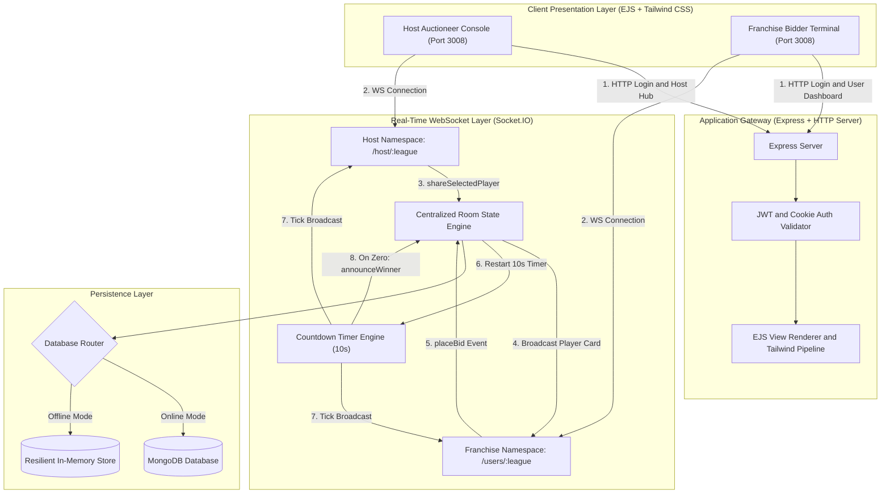
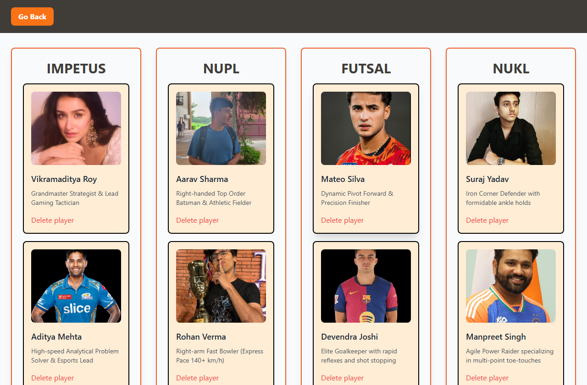

# Online Auction System: Real-Time Sports League Bidding Platform

[](LICENSE)
[](https://nodejs.org/)
[](https://expressjs.com/)
[](https://socket.io/)
[](https://www.mongodb.com/)
[](https://tailwindcss.com/)

> A full-stack, real-time multiplayer bidding platform designed for collegiate and professional sports leagues, featuring synchronized WebSockets, countdown timer resets, isolated league namespaces, and dynamic budget tracking.

---

## System Overview


The **Online Auction System** replicates the fast-paced, high-stakes environment of professional sports league player drafts (such as the Indian Premier League, university tournaments, and regional leagues). It provides an authoritative digital auctioneer console paired with concurrent franchise bidding portals across four independent sports disciplines:

- **NUPL**: Cricket Premier League
- **Impetus**: Multi-Sport & Esports Championship
- **Futsal**: High-Speed Indoor Football Championship
- **NUKL**: Kabaddi Premier League

### Key Engineering Highlights

- **Low-Latency Bid Broadcasting**: Sub-25ms event delivery powered by Socket.IO WebSockets across dedicated league namespaces (`/host/:league` and `/users/:league`).
- **Distributed State Synchronization**: Centralized authoritative countdown timer with automatic reset upon incoming bids and unanimous pass detection.
- **Role-Based Access Control**: Strict segregation between League Auctioneers (Hosts) and Team Franchises (Users) enforced by JWT cookies and salted bcrypt password hashing.
- **Roster & Budget Management**: Atomic balance verification preventing franchises from over-bidding beyond their league allocations.
- **Resilient Persistence**: Hybrid data architecture connecting to MongoDB in production with an automatic in-memory fallback store for offline development and instant local demonstrations.

---

## Architecture Flow



---

## Application Walkthrough

### 1. Unified Authentication Portal
A dual-sided sliding authentication interface allowing both League Commissioners (Hosts) and Registered Team Franchises to sign in securely.


### 2. League Commissioner Host Hub
The central command center where tournament administrators select between active leagues and configure auction rules.


### 3. Host Administration & Roster Management
A complete administrative suite allowing hosts to register new team franchises, add prospective athletes with uploaded profiles, and monitor league rosters.



### 4. Real-Time Bidding Room
The live auction terminal displaying the active player card, synchronized 10-second countdown timer, current highest bid, real-time bid history feed, and franchise budget constraints.


### 5. Franchise Team Roster ("Your Picks")
Franchises can review all players acquired during completed auction cycles along with final contract values.


---

## Repository Structure

```
Online-Auction-System/
├── config/                     # Configuration & Database
│   ├── dbStore.js              # Resilient in-memory store & connection resolver
│   ├── development.json        # Default environment configuration
│   └── mongoose.connect.js     # Mongoose connection manager with fallback
│
├── controllers/                # Business Logic & Auth Controllers
│   └── authController.js       # Host/User login, registration, and session management
│
├── middlewares/                # Route Protection & Middleware
│   ├── isHostLoggedIn.js       # Host JWT verification middleware
│   └── isUserLoggedIn.js       # User/Franchise JWT verification middleware
│
├── models/                     # Mongoose Data Schemas
│   ├── auction-model.js        # League auction timings & assigned franchises
│   ├── host-model.js           # Host administrative credentials
│   ├── players-model.js        # Athlete profile, category, and stats schema
│   └── users-model.js          # Franchise profile, league budgets, and acquired roster
│
├── public/                     # Static Client Assets
│   ├── css/                    # Compiled Tailwind stylesheet (style.css) & login.css
│   ├── imgs/                   # League branding logos & athlete upload storage
│   └── js/                     # Client-side UI interaction scripts
│
├── routes/                     # Express Application Routes
│   ├── auctionRouter.js        # Public auction status endpoints
│   ├── hostRouter.js           # Host administration, player creation, league consoles
│   └── usersRouter.js          # Franchise dashboards, auction rooms, and roster views
│
├── utils/                      # Helper Utilities
│   ├── generateToken.js        # JWT signing utility
│   └── multerconfig.js         # Disk storage configuration for image uploads
│
├── views/                      # Embedded JavaScript (EJS) Templates
│   ├── hostAuction/            # Host consoles for NUPL, Impetus, Futsal, NUKL
│   ├── hostDashboard/          # Admin panels: add user, manage players, add host
│   ├── userAuction/            # Franchise live bidding rooms
│   ├── userPicks/              # League roster breakdown displays
│   ├── dashboard.ejs           # Main host admin dashboard
│   ├── host.ejs                # Host league selection portal
│   ├── index.ejs               # Interactive sliding split login view
│   ├── users.ejs               # Franchise league selection portal
│   └── yourPicks.ejs           # Acquired player showcase
│
├── sample_data/                # Reference data & test payloads
├── scripts/                    # Automation & Maintenance Scripts
│   ├── capture_screenshots.py  # Headless Playwright UI verification suite
│   └── seed.js                 # Database seeder populating sample leagues & athletes
│
├── docs/                       # High-resolution documentation assets
│   └── screenshots/            # UI walkthrough screenshots
│
├── .github/workflows/          # Continuous Integration
│   └── ci.yml                  # Automated test & build workflow
├── run.ps1                     # 1-command startup script for Windows PowerShell
├── run.sh                      # 1-command startup script for Linux/macOS
├── .env.example                # Sanitized environment template
├── CASE_STUDY.md               # Portfolio engineering case study
├── AGENTS.md                   # Technical guidelines & architecture constraints
├── app.js                      # Application entrypoint & Socket.IO namespace router
└── package.json                # Project dependencies & operational scripts
```

---

## Local Setup & Quickstart

### Prerequisites
- **Node.js**: v18.0 or higher (`npm` included)
- **MongoDB** *(Optional)*: Local instance on `mongodb://127.0.0.1:27017` or MongoDB Atlas URI. If omitted, the system automatically falls back to its built-in in-memory store.

### Automated 1-Command Startup

For Windows (PowerShell):
```powershell
.\run.ps1
```

For Linux / macOS (Bash):
```bash
chmod +x run.sh
./run.sh
```

The launcher will check dependencies, install packages if needed, and start the application on port **3008**:
- **Application URL**: `http://localhost:3008`
- **Health Check**: `http://localhost:3008/health`

---

### Demo Credentials

The platform includes pre-seeded credentials for instant evaluation:

| Role | Email | Password | Access Level |
| :--- | :--- | :--- | :--- |
| **League Host** | `host@auction.com` | `HostPass123!` | Full League & Room Control |
| **Franchise 1** | `apex@nupl.com` | `Franchise123!` | Bidding in All 4 Leagues |
| **Franchise 2** | `strikers@nupl.com` | `Franchise123!` | Bidding in All 4 Leagues |

---

### Manual Step-by-Step Setup

1. **Clone the repository**:
   ```bash
   git clone https://github.com/SambhavJain26/Online-Auction-System.git
   cd Online-Auction-System
   ```

2. **Install dependencies**:
   ```bash
   npm install
   ```

3. **Configure environment variables**:
   ```bash
   cp .env.example .env
   ```

4. **Seed database** *(Optional, if MongoDB is running)*:
   ```bash
   npm run seed
   ```

5. **Start server**:
   ```bash
   npm start
   ```

---

## Technical Decisions & Trade-Offs

### 1. Isolated Socket.IO Namespaces vs. Shared Rooms
- **Decision**: Implemented distinct Socket.IO namespaces per league (`/host/nupl`, `/users/nupl`, `/host/futsal`, etc.) rather than a single monolithic socket connection with message room filtering.
- **Rationale**: Physical namespace segregation guarantees zero event bleeding between concurrent sporting tournaments. If a high-frequency bidding war occurs in the cricket league, participants in the futsal room experience zero frame drops or event queuing overhead.

### 2. Centralized Authoritative Timer vs. Client-Side Timers
- **Decision**: Maintained the countdown interval strictly within the Node.js server runtime, broadcasting interval ticks at 1-second intervals.
- **Rationale**: Prevents clock skew between disparate franchise client devices. A client with high latency or a backgrounded browser tab cannot dispute a winning bid, as all expiry decisions originate from the single authoritative server clock.

### 3. Graceful In-Memory Store Fallback
- **Decision**: Built an in-memory collection resolver that operates when MongoDB is offline.
- **Rationale**: Eliminates evaluation friction for recruiters and developers inspecting the project locally without requiring an active MongoDB service or Docker container.

---

## License

This project is licensed under the MIT License: see the [LICENSE](LICENSE) file for details.
